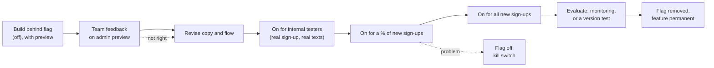

# Impact monitoring: development plan

**What we're building:** automated, low-burden impact monitoring for the text
service, plus the plumbing for fair comparisons:

- a baseline captured at sign-up (Tool 1)
- monthly SMS check-ins recorded through auto-responders (Tool 2)
- an end-of-programme check with a validated language measure as the primary
  outcome (Tool 3)
- deprivation from postcode
- version tests and draw rounds

Everything ships dark behind flags. Current families' experience doesn't
change.

The approach and rationale, for non-technical readers, are in
[impact-monitoring.md](impact-monitoring.md). The evidence base is Matthews et
al. (2026), *Can Digital Parenting Interventions Benefit Early Language
Development?* (protocol and data: osf.io/yxsa4).

**How to use this plan:** pick up work by step number ("let's work on step 7").
Each step is one small PR, or a non-code task. It links to its spec section
below. Update the **Status** column as steps land.

## Contents

| Section | What's in it |
| --- | --- |
| [Step tracker](#step-tracker) | The ordered list of steps: what, where specified, flag, status |
| [0. How we build and ship](#0-how-we-build-and-ship) | Rules, flags, feature lifecycle, definition of done |
| [1. Goals and decisions](#1-goals-and-decisions-so-far) | Decisions made so far |
| [2. What the codebase gives us](#2-what-the-codebase-gives-us-today) | Starting point and gaps |
| [3. Principles](#3-cross-cutting-principles) | Rules every step follows |
| [4. Foundations (0.x)](#4-phase-0-shared-foundations) | Data fixes, enrolment, storage, views, deprivation, allocation, flags, previews |
| [5. Tool 1: baseline at sign-up](#5-feature-1-baseline-captured-during-sign-up-tool-1) | Specs 1a–1f |
| [6. Tool 2: auto-responder feedback](#6-feature-2-auto-responders-that-gather-feedback-tool-2) | Specs 2a–2e |
| [7. Tool 3: end-of-programme check](#7-feature-3-child-language-check-and-end-of-programme-check-tool-3) | Specs 3a–3c |
| [8. Measurement schedule](#8-measurement-schedule-wales-52-weeks) | What's sent when |
| [9. Analytics](#9-analytics-wiring-summary) | Views, Skadi, Blazer |
| [10. Testing](#10-testing-approach) | What to test, per layer |
| [11. Evaluation design](#11-evaluation-design-primary-outcome-comparisons-and-analysis-plan) | Primary outcome, comparisons, analysis plan, draw rounds |
| [12. Rollout notes](#12-rollout-notes) | Rollout stages and deadlines |
| [13. Open questions](#13-open-questions-and-risks) | Decisions still needed |

## Step tracker

Status: **To do**, **In progress**, **Done**. The **Flag** column gives the
Flipper flag the step ships behind (all off by default). "Invisible" means the
step reaches current families but changes nothing they see.

| Step | What | Spec | Flag | Needs | Status |
| --- | --- | --- | --- | --- | --- |
| **M0** | **Safe foundations: nothing changes for parents** | | | | |
| 1 | Stop survey answers being written for other users | 0.D D1 | — (fix) | — | To do |
| 2 | Personal-data survey questions: anonymise, no pre-fill | 0.D D6 | — (fix) | — | To do |
| 3 | Structured checkbox answers + backfill; lock option edits | 0.D D3, D4 | — (fix) | 1 | To do |
| 4 | Unique answer index | 0.D D2 | — | 1, approved duplicate check | To do |
| 5 | Review received SMS bodies on anonymisation | 0.D D9 | — | — | To do |
| 6 | Bring `docs/architecture.md` up to date | 0.0 | — | — | To do |
| 7 | Flipper, `Impact::Feature` gate, `internal_tester`, flags-off safety suite | 0.7 | all off | — | To do |
| 8 | Programme timeline | 0.1 | — (invisible) | — | To do |
| 9 | `impact_enrolments` (new sign-ups + observe-only Wales backfill) | 0.2 | — (invisible) | 7, 8 | To do |
| 10 | `impact_measurements` + access tokens | 0.3 | — | 9 | To do |
| 11 | scenic + first report views + Skadi schema | 0.4 | — | 9 | To do |
| 12 | Click telemetry (+ UTM tags) | 2a | `impact_link_utm` | 11 | To do |
| **M1** | **Mock-ups for team feedback (admin-only)** | | | | |
| 13 | Preview framework, demo families, en/cy toggle | 0.8 | `impact_previews` | 7 | To do |
| 14 | `AutoResponseMatch` decide/apply split + SMS simulator | 0.8 | `impact_previews` | 7 | To do |
| 15 | Sign-up previews: about-you, child check, signposting result | 0.8, 1a–1c | `impact_previews` | 13 | To do |
| 16 | Simulator scenarios: activities-suitable, check-ins, confidence, signpost SMS | 0.8, 2b–2e, 1d | `impact_previews` | 14 | To do |
| 17 | End-of-programme check preview (placeholder questionnaire) | 0.8, 3c | `impact_previews` | 13 | To do |
| 18 | Draw-round previews | 0.8, E7 | `impact_previews` | 13, 14 | To do |
| 19 | Team feedback round; revise copy; sign off each preview | — | — | 15–18 | To do |
| **M2** | **Deprivation and evaluation plumbing** | | | | |
| 20 | Deprivation lookup: versioned areas, latest WIMD, sign-up job, backfill | 0.5 | — (invisible) | B | To do |
| 21 | Admin deprivation filter + "Copy user IDs" | 0.5 | — | 20 | To do |
| 22 | Allocation fields, content gate, `impact_exposures`, analysis export | 0.6 | — | 9 | To do |
| 23 | Import Pre-programme answers | 1e | — (invisible) | 3, 10 | To do |
| 24 | Record replies to the activities-suitable text (same texts) | 2b | `impact_record_feedback_replies` | 10, 14 | To do |
| **M3** | **Baseline at sign-up (new sign-ups)** | | | | |
| 25 | About-you fields + consent columns | 1b | `impact_about_you` | 9, B | To do |
| 26 | Child talking, confidence and home-talk instruments | 1a | (used by 27) | 10 | To do |
| 27 | Child talking check step; retire the Pre-programme link for enrolled sign-ups | 1c | `impact_child_check` | 25, 26, A, 19 | To do |
| 28 | Signpost follow-up SMS | 1d | `impact_signpost_sms` | 27 | To do |
| **M4** | **Monthly check-ins (new sign-ups)** | | | | |
| 29 | Monthly check-in + branching replies | 2c | `impact_monthly_check_in` | 24 | To do |
| 30 | Strategy tagging and wording (first version test) | 2d, C3 | `impact_strategy_wording` | 29, 22, C, D | To do |
| 31 | Month-6 confidence text | 2e | `impact_month6_confidence` | 29 | To do |
| **M5** | **Primary outcome (new sign-ups)** | | | | |
| 32 | Validated language instrument | 3a | (used by 27, 33) | E | To do |
| 33 | End-of-programme check (replaces offboarding for enrolled sign-ups) | 3c | `impact_end_check` | 32, 26 | To do |
| **M6** | **Comparisons** | | | | |
| 34 | Draw rounds | E7 | `impact_draw_round` | 22, D, sign-off on cap behaviour | To do |

**Non-code prerequisites** (referenced by letter in **Needs**; run alongside M0
and M1):

- **A:** DPIA
- **B:** privacy notice update
- **C:** pre-registration (E1, E4)
- **D:** ethics review
- **E:** questionnaire licence (E2)

---

## 0. How we build and ship

The aim is to **merge and deploy small changes to production as soon as
possible**, without changing anything for current families until we choose to,
and to get **team feedback on working versions early**.

### 0.a Rules

1. **Every parent-facing change ships behind a Flipper flag that is off by
   default** (0.7). Deploying code changes nothing until a flag is switched on.
2. **Current families keep their experience unchanged.** New features apply
   only to families who sign up *after* that feature is switched on.
   - A family's features are **pinned when they enrol**. Switching a flag on
     never adds a feature to families already enrolled.
   - Switching a flag **off** always wins. It is the kill switch.
3. **Changes that do reach current families must be invisible to them**, and
   are listed explicitly:
   - the data-integrity fixes (0.D)
   - better click tracking (2a)
   - saving "Are the activities suitable?" replies as data, with the same texts and the
     same replies (2b)
   - the deprivation lookup (0.5)
   - importing Pre-programme answers (1e)
   - observe-only enrolment (0.2)
4. **Additive data changes only.**
   - New tables and new nullable columns.
   - Never rewrite or change the meaning of an existing column. Backfills write
     only to new columns.
   - Old columns are removed only in a later clean-up PR, once nothing reads
     them.
5. **No demo or test data in the analysis.**
   - Previews use in-memory fake families and never write to the database.
   - Real test sign-ups by the team are marked `internal_tester`. They are
     excluded from every report, export and allocation.
6. **A "flags off" safety net.** One regression suite asserts that, with every
   impact flag off, today's journeys behave exactly as now:
   - sign-up and onboarding
   - weekly message
   - auto-responses
   - feedback, nudge and offboarding jobs
   - broadcasts

### 0.b Lifecycle of a feature



- **Preview first (0.8).** Every parent-facing feature starts as a **working
  admin-only preview**: the real views, wording and logic, rendered for a fake
  family, plus an **SMS simulator** for text conversations. This is the
  mock-up the team gives feedback on. It is the first version of the real
  feature, not a throwaway.
- **Each step is a flag change, not a deploy.** Every change of state for real
  families is logged in `impact_exposures` (0.6), so monitoring can show what
  changed and when.

### 0.c Definition of done (every PR)

- Tests written and passing. For parent-facing changes: flag on, flag off, and
  the flags-off safety suite.
- A preview, for parent-facing screens and texts.
- The flag is off by default, and named in the PR description.
- No change for current families, or the invisible change is listed in the PR
  description.
- CHANGELOG line. `docs/architecture.md` updated if the schema, flows or
  `recurring.yml` changed.
- `./do ci` green. Draft PR, reviewed and merged by a human (`AGENTS.md`).
- After deploy: switched on for internal testers. Wider rollout is a separate,
  logged decision.

---

## 1. Goals and decisions so far

**Goal:** collect light-touch, automated evidence on the causal chain the
Matthews trial tested:

> parent engages with content → parent tries strategies → child language grows

The service should stay low-burden. The trial found *burden* and *opportunity
cost* were the lowest-rated acceptability dimensions, and "lack of time" was
the main barrier.

**Direction:** the **core** measures become automated and built into the
service:

| Tool | Becomes |
| --- | --- |
| Tool 1 | The baseline is captured during sign-up |
| Tool 2 | Feedback is gathered through auto-responders |
| Tool 3 | A single end-of-programme check replaces offboarding |

**Ad-hoc** surveys stay manual, sent through admin broadcasts. That feature is
left untouched.

**Decisions:**

| Decision | Choice |
| --- | --- |
| Who gets new features | **New sign-ups only (Wales first), from each feature's switch-on date.** Features are pinned at enrolment. The design must cope with future cohorts as the service scales. |
| Current families | **Experience unchanged** (first_uk and existing Wales families). Only the invisible changes listed in §0.a reach them. |
| Shipping | **Merge and deploy early, dark, behind Flipper flags** (off by default). Staged rollout: internal testers → % of new sign-ups → all new sign-ups (§0, 0.7). |
| Mock-ups | **Working admin-only previews in the app, plus an SMS simulator**, built early for team feedback (0.8, milestone M1). |
| Manual surveys | **Unchanged.** Admin broadcasts with a `{{survey_link}}` and a survey from the survey builder stay as they are, used for ad-hoc surveys (e.g. Early Insights). The data-integrity fixes in 0.D change how survey *answers are stored*, not how surveys are created or sent. |
| Tool 1 | **Most of the Pre-programme survey moves into sign-up and onboarding**, balanced against friction (see §5). The baseline development check is an optional onboarding step. |
| Tool 1 triage outcome | **Signpost only.** No SLT capacity, so we never promise a call. Worried families get a gentle message pointing to their Health Visitor or GP, or to the Speech and Language UK Progress Checker. |
| Tool 2 | **Auto-responders that gather feedback.** The existing auto-response system is extended so that replies are recorded as data. It starts with the existing "Are the activities suitable?" text, then adds the monthly check-in. |
| Tool 3 | **One end-of-programme check** replaces the offboarding survey: primary outcome (validated questionnaire), re-check and service feedback in one flow. The month-6 language check is dropped to fund it. No LanguageScreen. |
| Deprivation | **Key requirement, moved into Phase 0.** Work out a deprivation decile from the sign-up postcode, and let admins filter users by it. |
| Parent education | **Collect it.** Reuse the Pre-programme survey's 5-level wording so old and new answers line up. It is the trial's key moderator. |
| Pulse cadence | **Monthly.** |
| Existing Wales users | **No change to their experience.** Observe-only enrolment. Their Pre-programme answers are imported where they exist (invisible). No check-ins, no education text. |
| SLT and Welsh translation | **Possibly available.** Review is a release gate with a fallback (§5, 1a). |
| Analytics | **Skadi events and dashboards, plus Postgres reporting views.** |
| Primary outcome | **Child's age-standardised language score at the end of the programme**, from a validated, age-normed parent questionnaire. `has_degree` is the pre-specified moderator. Pre-registered (§11 E1, E4). |
| Outcome measures | **Validated and age-normed, used as published** (lead candidate UK-CDI, plus a Welsh adaptation). The home-made tick-list is dropped as an outcome (§11 E2). |
| Comparisons | **Committed:** version tests (random versions for new sign-ups when a feature changes) and **draw rounds** when sign-ups exceed places. Monitoring also benchmarks against the trial and between cohorts, but those are descriptive only. Other designs are future options (§11 E3, E8). |
| Draw rounds | Equal odds within each education level (no tilt; any priority by area, not education). **The oldest age band always starts now.** Waiting families get a start-date text plus a **monthly general (non-language) parenting tip**. Delay length decided later (a setting, 8–12 weeks). Vouchers for the pre-start check in both groups (§11 E7). |
| Month 6 and vouchers | **Month-6 language check dropped** (the confidence text stays). **Vouchers** for the end-of-programme language section and the draw-round pre-start check. |

---

## 2. What the codebase gives us today

These findings shape the design. File references are to the repo root.

| Area | What exists | Gap or problem |
| --- | --- | --- |
| Programme position | Derived from `last_content_id`, `programme_message_count` (`app/models/user.rb:97`), `programme_length` (52 for Wales), `finished_content_at`. | No "programme week" concept. |
| Cohorts | `enum :cohort, {first_uk: 0, wales: 1}`. Wales-only behaviour is gated by `user.wales?` checks spread across jobs. | No way to opt a set of users into a feature or experiment. |
| Surveys (builder) | `Survey` → `SurveySection` → `Question` → `Answer`. Types are `text`, `check_boxes`, `radio_buttons`. | Data-integrity problems: see 0.D. |
| Surveys in production | Only **Pre-programme** and **Early Insights**. | There is **no "Offboarding" survey**, so `OffboardingMessageJob` returns early and finished Wales parents get no offboarding text (0.D, D8). |
| Survey sending | Manual: `Admin::BroadcastsController` + `SendBroadcastJob` (pasted user IDs, creates a `SurveySend`). Automatic: Pre-programme via the sign-up thank-you page (Wales) + a daily reminder; Offboarding (missing, see above). Automatic triggers were removed in #504. | Surveys are looked up by hard-coded `title_en`, so renaming one in admin silently breaks its flow. |
| Pre-programme survey | Education (5 levels), older children, motivation, information sources, CBeebies awareness/trust/recommend, **confidence in 4 areas** (5-point), **9 home activities in the past 7 days** (5-point), relatability, importance of Welsh, free text, contact consent. 5–10 minutes. | Several of these are core baseline measures stored as free text. The older-children question still says "9–27 months". |
| Early Insights survey | Qualitative experience questions, a £10 voucher, an **email address (asked twice)**, and consent to a phone call. | The email addresses are personal data held in `answers`. Anonymisation doesn't clear them (D6). |
| Research consent | `users.can_be_contacted_for_research`, `can_be_quoted_for_research` and `consent_given_at` exist in the schema. | **Nothing in the app sets them.** Consent lives only in free-text survey answers (D7). |
| Inbound SMS | `ResponseMatcherJob` → `AutoResponseMatch` (exact match on the whole message, plus `user_conditions` on User columns, plus `update_user`). The activities-suitable Yes/No text (messages 2 and 18: "Are the activities we send you suitable for your child?") uses `asked_for_feedback`. | Replies are matched but not recorded as answers, and they aren't tied to the question asked. |
| Click tracking | `/m/:token` → `MessagesController#next` sets `messages.clicked_at`, then redirects to bbc.co.uk. | Overwritten on each click, and link-preview bots aren't filtered out. View duration can't be seen once the parent is on the BBC site. |
| Postcode | Required at sign-up. Geocoded by Mapbox (`app/lib/geokit/geocoders/application_geocoder.rb`) for the local authority. | No LSOA or deprivation data. The team does WIMD targeting outside the system (#489). |
| Ahoy / Skadi | Server-side events on sign-up and survey pages. Skadi `dashboard_custom_schema = {}`. | Skadi needs an ActiveRecord model with a `date` field per dataset, and it respects cookie consent. |
| Anonymisation | `User#anonymise!` (3 years) clears names and phone, and blanks *sent* message bodies. | It doesn't touch survey answers (D6). Received SMS bodies are kept, to be confirmed by review (D9). |
| Feature flags | ENV flags only (`SMS_ENABLED`, `SIGN_UP_OPEN`, `ENABLE_WELSH`). | No per-family or percentage flags (→ Flipper, 0.7). |
| Previews | `Admin::SurveysController#preview` renders the real `surveys/edit` view with a fake user. | The pattern to reuse for impact previews (0.8). |
| Environments | Production on Heroku; `app.json` exists but there is no staging app. | Previews are admin-only in production (0.8); a review app is optional. |
| Docs | `docs/architecture.md` must be updated in the same PR as schema, flow or `recurring.yml` changes. | Already stale (PR 0.0). |

---

## 3. Cross-cutting principles

1. **Two survey systems, each with a clear job.**
   - **Core measures** are automated, versioned code-defined instruments with
     structured answers, stored in `impact_measurements`. They are used for
     anything we track over time or compare between groups.
   - **Ad-hoc surveys** use the existing survey builder and manual broadcasts,
     for one-off questions and exploratory research.

   If an ad-hoc question turns out to matter long-term, promote it to a core
   measure rather than re-sending the survey.
2. **Our database is the source of truth; Skadi shows behaviour.** Skadi misses
   anyone who declines cookies. Impact figures come from our tables and views.
3. **No child or answer data in analytics events.** Event properties hold only
   step names, instrument keys and age bands.
4. **Instruments live in code, are versioned, and are reviewed by an SLT.**
   Store `instrument_version` with every response.
5. **Same wording, same scale, at every timepoint.** Baseline, month 6 and the
   end-of-programme check repeat the confidence and home-activity items word for
   word, so change can be measured. Reuse the Pre-programme survey's wording
   where it exists, so imported answers line up.
6. **Bilingual from day one.** Every parent-facing string goes in `en` and
   `cy`. Store answers as language-independent keys, never as display text.
7. **Supportive wording, no SEND terminology.** Never say "at risk" or "delay".
8. **Budget for burden.** Add at most about one extra SMS a month. Skip a parent
   who has had a feedback, bilingual or offboarding text **or a broadcast** in
   the last 5 days. Avoid emoji in SMS: one emoji switches the message to
   UCS-2, which cuts a segment to 70 characters and roughly doubles the cost.
9. **Ship dark, in small PRs.** See §0.
10. **Privacy first.** Get the DPIA and privacy notice signed off before
    milestone M3. They should cover child development data, parent education, the
    deprivation lookup, and the personal data in ad-hoc surveys. Never run
    migrations, backfills or queries against production without asking first
    (`AGENTS.md`).

---

## 4. Phase 0: shared foundations

### 0.0 Bring `docs/architecture.md` up to date

Remove the stale survey-trigger flow, `interests` and the old `BATCH_SIZE`.

### 0.D Data-integrity fixes

Do these first. Some affect data being collected today. None of them changes
how admins create or send surveys.

**D1. Survey answers can be written for other users. Fix first.**

- `SurveysController#survey_params` permits `answers_attributes: [:id,
  :user_id, ...]`, and the form sends `user_id` as a hidden field
  (`app/views/surveys/edit.html.erb`).
- Nested attributes are resolved against *all* answers to a question, not just
  this user's. So anyone with a valid survey link can probably:
  - overwrite another parent's answer by sending its `id`
  - create answers in another parent's name by changing `user_id`
- Fix: drop `user_id` and `id` from the permitted params. Find or build each
  answer server-side by `(question, @user)`, and remove the hidden field.

  ```ruby
  def save_answers
    @survey.questions.for_language(@user.language).each do |question|
      response = params.dig(:answers, question.id.to_s)
      next if response.nil?

      question.answers.find_or_initialize_by(user: @user).update!(response:)
    end
  end
  ```

- Tests:
  - A tampered `user_id` is ignored.
  - Another user's answer `id` is rejected and that answer is unchanged.
  - A normal submit still updates the parent's own answers.

**D2. Duplicate answers.** Nothing stops two answers per user per question.

- Run a read-only check for duplicates (in Blazer, with approval).
- Resolve any found, then add a unique index on `answers (question_id,
  user_id)`.
- Test: the model or index rejects a duplicate.

**D3. Checkbox answers can't be split reliably.**

- `Answer#response=` joins ticked options with `", "`. Several live options
  contain commas, e.g. Pre-programme Q4a "Searching online, like Google,
  ChatGPT or YouTube" and "Social media, like Instagram or TikTok". The stored
  text can't be split back into the options that were ticked.
- Welsh answers are stored as Welsh text, so the same option has two spellings.
- Fix:
  - Add `answers.response_values` (an integer array of option indexes) and
    write it on every save. Keep `response` for display.
  - Backfill existing rows by matching against the question's options in the
    respondent's language, longest option first.
  - Flag rows that don't match fully (e.g. edited options) for review rather
    than guessing.
- Tests:
  - Options containing commas round-trip correctly.
  - A Welsh answer gives the same indexes as the English one.
  - Backfill: exact matches, and partial matches flagged.

**D4. Editing options after answers exist changes their meaning.**

- Once a question has answers, admins can only *append* options, not remove or
  reorder them. The admin form shows why.
- Test: model validation, and the admin form message.

**D5. Answers aren't tied to a send or timepoint.** Resubmitting overwrites the
earlier answers, and the form pre-fills them.

- For ad-hoc surveys this is acceptable. Document it in the admin survey help:
  "send a new survey for each round".
- Core measures avoid it by design (0.3).

**D6. Personal data in survey answers.**

- Early Insights collects email addresses for vouchers, as free-text answers.
  `User#anonymise!` doesn't clear answers, yet the survey promises that personal
  details are deleted after three years.
- Fix:
  - Add `questions.personal_data` (boolean, settable in the admin form).
  - `anonymise!` blanks answers to those questions.
  - Reporting views and exports exclude them.
  - The survey form doesn't pre-fill them, so a forwarded link doesn't reveal
    an email address.
- **Decided:** voucher email addresses are blanked by the normal 3-year
  anonymisation, the same as other personal data. No earlier deletion step.
- Flag the two Early Insights email questions as `personal_data` once the
  column exists (an admin edit, no code).
- Tests: `anonymise!` blanks flagged answers only; no pre-fill; the views omit
  them.

**D7. Research consent isn't stored as data.**

- Onboarding sets `can_be_contacted_for_research` and `consent_given_at` (1b).
- Backfill from Pre-programme Q13 answers.
- The Early Insights phone-call consent stays survey-specific.
- Tests: onboarding sets the columns; backfill mapping.

**D8. The offboarding text is silently not sent.**

- `OffboardingMessageJob` returns early when no "Offboarding" survey exists,
  and production has none.
- **Decided:** no interim action. The end-of-programme check (3c) replaces it,
  with no dependence on a survey title.

**D9. Review: received SMS bodies are kept after anonymisation.**

- `User#anonymise!` blanks the bodies of messages *sent* to a parent, but keeps
  the parent's own replies (`status: "received"`). These can contain names or
  other personal details. The team believes this is intended, but it hasn't
  been checked.
- A review task, not a feature:
  1. Confirm the reason for keeping them (e.g. research analysis of replies).
  2. Check the privacy notice and DPIA cover it.
  3. Record the decision in `docs/architecture.md`.
  4. Add a test that pins the agreed behaviour, so it can't change by
     accident.
- If the review decides they should go, blank them in `anonymise!` (one line,
  plus a test). Recorded answers from 2b are structured values, not message
  text, so they are unaffected either way.

**D10. Content fixes, no code.**

- Pre-programme Q2 still says "9–27 months" (the age range is now 6–18).
- Renaming "Pre-programme survey" in admin would silently break the thank-you
  link and reminders. Note this in the admin help until 1c retires that link.

Click-data quality (overwritten `clicked_at`, bots) is fixed in 2a.

### 0.1 Programme timeline

- `users.programme_started_at` is set by the first content message
  (`SendMessageJob`). Backfill from the earliest content message's `sent_at`.
- `User#programme_week` and `User#programme_month`.
- Tests: week 0, week 52, a paused user, no messages yet; the backfill.

### 0.2 Impact enrolment

```
impact_enrolments
  user_id         (unique, FK)
  enrolled_at
  source          string   # "new_signup", "wales_backfill", later "family_hub_x", ...
  baseline_status string   # "expected" (new sign-ups), "imported" (from Pre-programme survey), "none"
  arm             string   # see 0.6 / §11 E5 (allocation)
  withdrawn_at
```

- `ImpactEnrolment.eligible?(user)` is the single rule. To start: Wales, and
  not anonymised.
- Enrolment sources:
  - **New sign-ups** are enrolled during onboarding.
  - **Existing Wales users** are enrolled by a backfill task as
    **observe-only** (`source: "wales_backfill"`). This gives no
    parent-facing features, so their experience is unchanged.
    `baseline_status` is `imported` if they answered the Pre-programme survey
    (1e), otherwise `none`. They contribute passive engagement data and
    imported answers only.
  - **Future cohorts** need only a new `source` and eligibility rule.
- **Feature pinning:** at enrolment, the impact features switched on for that
  user are recorded in `impact_exposures` (0.6). `Impact::Feature.on?(name,
  user)` is true only if the Flipper flag is on **and** the feature was pinned
  at their enrolment (0.7).
- Withdrawal (opt-out auto-response or an admin action) sets `withdrawn_at`.
- Kill switch: the ENV variable `IMPACT_MONITORING_ENABLED`.
- Tests: the eligibility matrix, backfill idempotency, withdrawal.

### 0.3 Measurement storage

```
impact_measurements
  user_id, impact_enrolment_id
  instrument          string   # "about_you", "child_talking_check", "home_talk", "confidence",
                               # "strategy_pulse", "feedback_suitable", "language_check", "service_feedback"
  instrument_version  integer
  timepoint           string   # "baseline", "week_8", "month_6", "end_of_programme", ...
  channel             string   # "web" | "sms" | "imported_pre_programme"
  message_id          (nullable FK: the SMS that asked it)
  access_token        string   # per-measurement link token for web forms (not users.survey_token)
  age_band            string
  child_age_in_days   integer
  sent_at, started_at, completed_at, expires_at
  answers             jsonb    # { item_key => value_key } — language-independent keys
  score               integer
  outcome             string
  unique (user_id, instrument, timepoint)
```

- Instrument classes live in `app/models/impact/instruments/`. Each one
  defines:
  - items per age band (i18n keys)
  - allowed answer keys
  - `score`
  - `outcome`
  - `VERSION`
- A row is created **when the measure is sent**, so response rate is
  `completed / sent`.
- Web forms use the row's own `access_token` and **never pre-fill** a previous
  timepoint, so a forwarded link reveals nothing.
- `anonymise!` blanks any free-text answer values.

### 0.4 Reporting view plumbing

- Add the **`scenic`** gem, so views are dumped into `db/schema.rb`.
- Pattern for each view:
  - A SQL file in `db/views/`.
  - A read-only model in `app/models/reports/`.
  - A `config.dashboard_custom_schema` entry with a `date` field.

  ```ruby
  class Reports::WeeklyEngagement < ApplicationRecord
    self.table_name = "reports_weekly_engagement"

    def readonly? = true
  end
  ```

  ```ruby
  config.dashboard_custom_schema = {
    weekly_engagement: {
      model: "Reports::WeeklyEngagement",
      fields: {
        date: {type: :date, select: true, filter: true, sql: "reports_weekly_engagement.sent_at"},
        programme_week: {type: :number, select: true, filter: true, split: true},
        clicked: {type: :boolean, select: true, filter: true, split: true},
        has_degree: {type: :boolean, select: true, filter: true, split: true},
      },
    },
  }
  ```

- Views hold de-identified columns only:
  - IDs, age band, language, local authority, cohort, enrolment source, arm
  - `has_degree`, deprivation decile and quintile
  - dates, scores, outcomes
- Also add `reports_survey_responses`: send and completion counts per survey,
  from `survey_sends` and `answers`, excluding personal-data questions. Ad-hoc
  survey response rates then sit alongside core measures.
- Tests: one model test per view, plus a test that no PII columns are present.

### 0.5 Deprivation lookup and filtering

This is a key requirement and replaces the off-system WIMD process.

**Data:**

- **Use the most recent feasible release of each nation's index.** "Feasible"
  means published as open data at small-area level, with a postcode-to-area
  route we can match (see Accuracy).
- **`deprivation_areas`** table:
  - `area_code`: LSOA in England and Wales, Data Zone in Scotland, SOA in
    Northern Ireland
  - `area_boundary_version` (e.g. `LSOA2011` or `LSOA2021`)
  - `nation`
  - `index_name` (e.g. `WIMD`)
  - `index_version` (the release year)
  - `rank`, `decile`, `quintile`
  - Unique on (`index_name`, `index_version`, `area_code`).
- **Versioned, never overwritten.** A new release is imported alongside the
  old one. Users are then recomputed against it. Each user's result records the
  version it came from, so analysis never mixes releases by accident.
- Loaded by one rake task, `deprivation:import[nation,index,version,file]`,
  from the official file. The source files are committed to `db/data/` so tests
  and environments match.
- **Wales (Wales cohort):** the latest WIMD release, about 1,900 rows. Imported
  as part of this PR.
- **first_uk cohort (England, Scotland, Northern Ireland):** imported manually,
  using the same rake task with each nation's latest index (IMD, SIMD,
  NIMDM). Then run the backfill for first_uk users by hand. No extra code is
  needed beyond nation-specific code formats in the lookup. Following
  `AGENTS.md`, ask before running either against production.

**Postcode to deprivation:**

- `DeprivationLookup` service: postcode → LSOA via postcodes.io (open data,
  free, can be self-hosted) → decile from `deprivation_areas`.
- Store on `users`: `deprivation_area_code`, `deprivation_decile`,
  `deprivation_quintile`, `deprivation_index` (e.g. `WIMD`),
  `deprivation_index_version`, `deprivation_checked_at`.
- Run it in a background job after sign-up (alongside
  `update_local_authority`) and whenever the postcode changes.
- A backfill job covers existing users, throttled to postcodes.io's rate
  limits.
- Failures leave the fields nil and report to AppSignal. A nightly retry picks
  up nils.

  ```ruby
  class DeprivationLookup
    def initialize(user)
      @user = user
    end

    def call
      area_code = PostcodesIo.area_code(@user.postcode, boundary: index.area_boundary_version)
      area = DeprivationArea.find_by(index_name: index.name, index_version: index.version, area_code:)

      @user.update!(
        deprivation_area_code: area_code,
        deprivation_decile: area&.decile,
        deprivation_quintile: area&.quintile,
        deprivation_index: index.name,
        deprivation_index_version: index.version,
        deprivation_checked_at: Time.current,
      )
    end

    private

    def index = @index ||= DeprivationArea.latest_index_for(@user.nation)
  end
  ```


**Accuracy:**

- **Boundary versions must match.** Each index is built on a particular
  small-area boundary set (e.g. WIMD 2019 on 2011 LSOAs). Postcode lookups may
  return a newer set. Store `area_boundary_version` per index, and map through
  the official ONS best-fit lookup when the two differ. Test this explicitly.
  If a nation's latest release has no workable mapping, the previous release
  may be the most recent *feasible* one. Record that choice in
  `docs/architecture.md`.
- Deciles are **nation-specific**: Welsh decile 1 ≠ English decile 1. Always
  store and report `deprivation_index` and `deprivation_index_version`, and
  never pool deciles across nations or versions.

**Admin:**

- Filter the users list by deprivation decile and quintile, as well as cohort,
  language, `has_degree` and enrolment status.
- A **"Copy user IDs"** button gives a list to paste into a broadcast. The
  broadcast feature itself is unchanged.

**Privacy:** postcodes already go to Mapbox. Add postcodes.io to the DPIA and
privacy notice. A decile is area-level, but combined with other fields it can
narrow down a family, so the small-number rules in §9 apply.

**Tests:**

- Service: postcodes.io stubbed with WebMock; decile mapping; boundary mapping;
  unknown or invalid postcode → nil; picks the latest imported version for the
  user's nation.
- Rake task: imports a version without touching other versions; rejects a
  duplicate import; each nation's code format.
- Jobs: sign-up job, backfill idempotency, retry, recompute after a new
  version.
- Admin: filter results; a system test for copying IDs.

### 0.6 Allocation, content gate and exposure logging

The full design is in §11 E5. In short:

- `impact_enrolments` gains `allocation_method`, `strata`, `allocated_at` and
  `allocation_seed`. Allocation happens after the about-you step.
- A `receives_content?` gate in `SendMessageJob`, separate from `contactable`.
- `impact_exposures` and a `service_version` tag.
- An analysis export rake task.

  ```ruby
  module Impact
    class Allocator
      def self.arm_for(enrolment, arms:, salt:)
        digest = Digest::SHA256.hexdigest([salt, enrolment.strata, enrolment.user_id].join(":"))
        arms[digest.to_i(16) % arms.size]
      end
    end
  end
  ```

  Hashing gives a deterministic, reproducible draw. If strata are small, switch
  to permuted blocks within each stratum, so the arms stay balanced.
- Ships with `allocation_method: "none"` for everyone, so nothing changes for
  parents. Version-test allocation (C3) and draw rounds (E7) are separate PRs
  in M6.
- Tests:
  - deterministic, stratified allocation and balance across a synthetic
    population
  - allocation is immutable
  - the content gate per arm (measures still sent)
  - exposures recorded on each rollout and variant change
  - the export has no PII columns and its variable names are stable

### 0.7 Feature flags (Flipper), the feature gate and internal testers

- Add **Flipper** with the ActiveRecord adapter. Mount **Flipper UI** under
  `authenticate :admin`. Only super admins can change flags; admins can view.
- **Flag names**, all off by default:

  | Flag | Feature |
  | --- | --- |
  | `impact_previews` | Admin preview menu |
  | `impact_record_feedback_replies` | 2b |
  | `impact_link_utm` | 2a UTM tags |
  | `impact_about_you` | 1b |
  | `impact_child_check` | 1c |
  | `impact_signpost_sms` | 1d |
  | `impact_monthly_check_in` | 2c |
  | `impact_strategy_wording` | 2d |
  | `impact_month6_confidence` | 2e |
  | `impact_end_check` | 3c |
  | `impact_draw_round` | E7 |

- **`Impact::Feature.on?(name, user)`** is the only way code checks a
  feature. It is true when:
  - `IMPACT_MONITORING_ENABLED` is on, and
  - the Flipper flag is on for that user (globally, for the
    `internal_testers` group, or within a percentage), and
  - the feature was pinned at the user's enrolment (0.2).

  For sign-up screens, which run before enrolment, the check uses the flag
  plus "is a new sign-up".

  ```ruby
  module Impact
    class Feature
      def self.on?(name, user)
        return false unless ENV["IMPACT_MONITORING_ENABLED"] == "true"
        return false unless Flipper.enabled?(:"impact_#{name}", user)

        user.impact_enrolment&.pinned?(name) || false
      end
    end
  end
  ```

  ```ruby
  Flipper.register(:internal_testers) { |actor| actor.respond_to?(:internal_tester?) && actor.internal_tester? }
  ```

  Call sites stay one line: `return unless Impact::Feature.on?(:monthly_check_in, user)`.
- **`users.internal_tester`** (boolean, set by admins on the user page):
  - a Flipper group, so features can be switched on just for the team using
    real sign-ups and real texts
  - excluded from every report view, export and allocation
- Tests:
  - the gate truth table (kill switch × flag × pinned × tester)
  - turning a flag on later doesn't add the feature to existing enrolments
  - turning it off removes it for everyone
  - the flags-off safety suite, e.g.:

    ```ruby
    test "every impact flag is off by default" do
      Impact::Feature::FLAGS.each { |flag| assert_not Flipper.enabled?(flag) }
    end

    test "weekly message is unchanged with impact flags off" do
      user = create(:user, child_birthday: 12.months.ago)

      assert_enqueued_jobs 0, only: SendImpactCheckInJob do
        SendMessageJob.new.perform(user)
      end
      assert_equal 1, user.messages.count
    end
    ```

  - testers are excluded from views
  - the flags-off safety suite (§0.a rule 6)

### 0.8 Admin previews and the SMS simulator (the mock-ups)

The team's way to see and comment on each new mechanism **before** any family
does. Visible only to signed-in admins, with the `impact_previews` flag on.

- **`/admin/impact/previews`**, one page per mechanism, each with an en/cy
  toggle and a choice of demo family (child age band, education, language):
  - sign-up: about-you fields, the child talking check per age band, and the
    signposting result (worried / not worried)
  - end-of-programme check, section by section
  - draw-round messages: the result ("starts now" / "starts later"), the
    waiting tip text, the pre-start check
- **SMS simulator** (`/admin/impact/sms_simulator`): pick a demo family and
  scenario, e.g.:
  - "Are the activities suitable?"
  - a monthly check-in (generic or strategy-specific)
  - the month-6 confidence text
  - the signpost follow-up

  It shows the outbound text exactly as sent (variables filled, segment count
  and encoding shown, so emoji or UCS-2 problems are visible). You type a
  reply, and it shows the matched auto-response, the answer that **would** be
  recorded, and the reply text.
- **How:**
  - Previews render the real views, instruments and i18n with in-memory fake
    objects, following `Admin::SurveysController#preview`.
  - The simulator uses the real message builders and a **dry-run** mode of
    `AutoResponseMatch`. This means a small refactor: split "decide the
    response" from "apply it" (update the user, record the answer, enqueue the
    reply). Nothing is saved, enqueued or sent.

    ```ruby
    class AutoResponseMatch
      Decision = Data.define(:auto_response, :answer_key, :reply_text)

      def decision
        @decision ||= Decision.new(auto_response: matched_response, answer_key: matched_response&.records_answer, reply_text: reply_text)
      end

      def deliver
        apply(decision)
      end
    end
    ```

    ```ruby
    reply = Message.new(user: demo_family, body: params[:reply], status: "received")
    @decision = AutoResponseMatch.new(message: reply).decision
    ```

- **Feedback loop:** share preview links with the team, collect comments on the
  PR or an issue, and change copy in i18n. Preview sign-off is the gate before
  a feature is switched on for internal testers.
- Previews start with placeholder content where a dependency isn't ready (e.g.
  the licensed questionnaire before the licence), clearly labelled.
- Tests:
  - every preview page renders in en and cy for each demo family
  - preview and simulator requests write nothing (`assert_no_difference` on
    `User`, `Message`, `ImpactMeasurement`; no enqueued jobs; `Sms::Client`
    never called)
  - non-admins get a 404

---

## 5. Feature 1: Baseline captured during sign-up (Tool 1)

**Purpose:**

- Capture each family's baseline: background, confidence, home talk and child
  communication.
- Gently signpost worried families.
- Collect most of the Pre-programme survey's content at sign-up, without making
  sign-up harder to finish.

### Where each Pre-programme item goes

| Pre-programme item | Destination | Why |
| --- | --- | --- |
| Q1 highest education | **Onboarding: `about_service` step** (optional, same 5 levels + "Prefer not to say") | The trial's key moderator; needed for every split |
| Q2 older children | **Onboarding: `about_service` step** (optional, yes/no) | Siblings were a stated barrier in the trial |
| Q13 contact consent | **Onboarding: `about_service` step** (checkbox → `can_be_contacted_for_research`) | Consent belongs in a column, not free text (D7) |
| Q8a confidence: talking and learning words | **Onboarding check step** (same wording and 5-point scale) | Baseline for parent confidence; repeated at month 6 and end |
| Q9b, 9f, 9g, 9h home talk (talk about what you're doing / what they point at, turn-taking play, babble turn-taking) and 9e books | **Onboarding check step** (same wording and scale) | Baseline for "parent tries strategies"; repeated at month 6 and end |
| *New:* age-band communication items, parent concern, home language | **Onboarding check step** | Child baseline and signposting |
| Q3 why signed up, Q4 information sources | **Ad-hoc "About you" survey** | Service insight, not impact. Partly covered by `referral_sources` |
| Q5–7 CBeebies awareness, trust, recommend | Recommend → **end-of-programme check**; awareness and trust → **ad-hoc "About you" survey** | Recommend is the trial's headline acceptability figure |
| Q8b–d confidence in other areas, Q9a/c/d/i other activities | **Ad-hoc "About you" survey** | Not language-focused; keeps onboarding short |
| Q10 relatability, Q11 Welsh importance, Q12 free text | End-of-programme check (Q10, Q12); **ad-hoc "About you" survey** (Q11) | |

**The ad-hoc "About you" survey** is built in the existing survey builder from
the Pre-programme items above that don't move to sign-up. The team sends it by
broadcast when they choose, e.g. around week 4. It needs no code. Once D3 and
D4 have shipped, its tick-box answers are stored reliably.

**Balancing friction:**

- Sign-up itself (`new`) is unchanged.
- `about_service` gains three **optional** questions, about 20 seconds.
- The check is a separate **optional, skippable** step after the welcome text is
  triggered, about 2 minutes.
- Guardrail: track the share of sign-ups reaching the welcome message, before
  and after each change, using Skadi funnel events and a database count. If it
  drops more than an agreed margin (e.g. 3 points over 4 weeks), roll back or
  move items.
- A version test (C3) can compare placing the check in onboarding vs sending it by SMS link in
  week 2.

### Iterations

**1a. Instruments (no UI)**

- `ChildTalkingCheck`: items grouped by age band.

  | Band | Example items |
  | --- | --- |
  | 6–11 months | Babbles, turns to their name, uses gestures |
  | 12–18 months | Points to show you things, says 1–3 words, understands "no" or "bye-bye" |
  | 18 months and over (scale) | Names objects, combines two words |

  It also asks about parent concern (3 options) and home language (3 options).
  The original mock-up's items are 18–24-month milestones, so they would flag
  almost every family in this cohort.
- `Confidence` and `HomeTalk`: the Pre-programme wording and scales, with keys
  matching the Pre-programme options so imported answers map straight across.
- Outcome rule: `"signpost"` if the parent is worried, or if items fall below an
  SLT-agreed threshold.
- **Fallback with no SLT:**
  - Use published public milestones word for word.
  - Only parent concern triggers signposting (`signpost_on_items: false` per
    `VERSION`).
  - Items are stored and scored but don't trigger signposting until thresholds
    are signed off.

  ```ruby
  module Impact
    module Instruments
      class ChildTalkingCheck < Base
        VERSION = 1
        SIGNPOST_ON_ITEMS = false

        def outcome(answers)
          return "signpost" if answers["concern"] == "worried"
          return "signpost" if SIGNPOST_ON_ITEMS && below_threshold?(answers)

          "no_action"
        end
      end
    end
  end
  ```

- **Welsh:** a release gate. If `cy` copy isn't checked, launch to
  English-language users first.
- ASQ-3 is copyrighted: license it, or use open milestones.
- Tests: table-driven tests for band boundaries, scoring and outcomes (thresholds
  on and off); answer keys match the Pre-programme options.

**1b. About-you fields on `about_service` (all new sign-ups)**

- Add to `users`:
  - `parent_education` (5 Pre-programme levels + `prefer_not_to_say` +
    `below_degree`, the last for SMS only)
  - `parent_education_recorded_at`
  - `has_older_children` (boolean)
- `User#has_degree` is true only for "went to university (or equivalent)",
  false for the other levels, and nil if unknown.
- The consent checkbox sets `can_be_contacted_for_research` and
  `consent_given_at` (D7).
- All three fields are optional, and they don't delay the welcome text.
- Tests:
  - Model: the `has_degree` mapping.
  - Controller: saves each field; blank is allowed; Welsh locale.
  - System: sign-up still completes with the fields blank.

**1c. "Your child's talking" check step (new sign-ups)**

- An optional step after `about_service` (and after allocation, 0.6):
  - age-band items (for signposting)
  - concern
  - home language
  - confidence
  - home talk
  - the **normed language baseline** (3a), for children at or above the
    instrument's age floor

  One section per screen (Alpine), with a Skip link as prominent as Continue.
  The normed baseline is the longest section, so it comes last and is saved
  separately. Skipping it doesn't lose the shorter answers.
- On submit:
  - Creates `impact_measurements` rows (`timepoint: "baseline"`).
  - Shows a supportive result page. Worried parents see a calm signposting
    block.
- **Retire the Pre-programme link** on the thank-you page for enrolled new
  sign-ups. The survey itself stays in the builder for ad-hoc use, and its
  reminder job only targets people who were sent it.
- Skadi events: `child_check_started`, `child_check_step` `{step}`,
  `child_check_completed`, `child_check_skipped`, `signpost_link_clicked`.
- Tests:
  - Controller: token, skip, submit, validation, cy.
  - System: the full journey, the skip path, axe accessibility, cy.
  - Thank-you page: the Pre-programme link isn't shown for enrolled users.
  - Skadi: the events carry no answer data.

**1d. Signpost follow-up SMS**

- One tracked-link SMS a few days later. Generalise `MessagesController#next`
  to an allow-list of hosts.
- Tests: sent once; the allow-list rejects other hosts.

**1e. Import existing Pre-programme answers (existing Wales users)**

- Depends on D3, so options map to indexes.
- Maps Pre-programme answers onto the new fields and instruments:
  - Q1 → `parent_education`
  - Q2 → `has_older_children`
  - Q13 → research consent
  - Q8a and Q9 items → `impact_measurements` with `channel:
    "imported_pre_programme"` and `timepoint: "baseline"`
- Sets `baseline_status: "imported"`. Runs once and can be re-run safely.
- Invisible to families (§0.a). No texts are sent to fill gaps; families with no
  Pre-programme answer simply have no baseline.
- Tests: the mapping per option in en and cy; idempotent; unmatched answers
  logged, not guessed.

**1f. Re-check at the end of programme:** part of 3c. It applies only to
families with a baseline (new or imported).

### Tracking

| Metric | Source |
| --- | --- |
| Share of sign-ups reaching the welcome text (friction guardrail) | `reports_enrolments` + Skadi funnel |
| About-you completion rates (education, siblings, consent) | `reports_enrolments` |
| Check start, skip and completion; drop-off by screen | `reports_baseline_checks` + Skadi events |
| Signposted share, by age band, language, `has_degree` and deprivation | `reports_baseline_checks` |
| Signpost click-through | `link_clicks` + Skadi `signpost_link_clicked` |
| Baseline confidence and home talk, new vs imported | `reports_baseline_checks` |

---

## 6. Feature 2: Auto-responders that gather feedback (Tool 2)

**Purpose:** passive engagement data, plus quick SMS questions whose replies are
**recorded as data**. It builds on the auto-response system the team already
uses.

### Iterations

**2a. Click telemetry (no parent-facing change). Do this first.**

- `link_clicks` table (`message_id`, `clicked_at`, `user_agent_family`,
  `likely_bot`), plus `messages.first_clicked_at`. Keep `clicked_at`.
- Flag link-preview bots and `HEAD` requests.
- UTM tags on BBC redirects, so view duration could come from the BBC.
- View `reports_weekly_engagement`, one row per content message:
  - programme week
  - delivered, clicked and replied
  - `has_degree`, deprivation, age band, arm
- Tests: multiple clicks; first click is stable; bot and `HEAD` handling; the
  allow-list.

**2b. Recorded replies: extend auto-responses**

- `users.pending_question` and `users.pending_question_expires_at` generalise
  `asked_for_feedback`.
- Sending any SMS question:
  - sets them
  - creates the `impact_measurements` row
  - links the row to the message
- `auto_responses.records_answer` (string, nullable): when a matched
  auto-response has it, `AutoResponseMatch`:
  1. writes the value to the user's open measurement for that question
  2. clears `pending_question`
  3. sends the auto-response text as usual
- Auto-response rows are conditioned on `{pending_question: "<key>"}` (and
  `language` for Welsh copy), using the existing `user_conditions` mechanism.
- Admins keep editing the reply copy at `/admin/auto_responses`, as they do
  today. New rows come from data migrations.
- `records_answer` is validated against the instrument's allowed answer keys.
- `AutoResponseMatch` changes:
  - Normalise replies further: strip punctuation, map "one" and Welsh "un",
    "dau", "tri" to digits.
  - Treat an expired `pending_question` as none.
  - STOP, PAUSE and other existing triggers behave exactly as today.
  - A late or unrecognised reply falls through to today's behaviour: the team
    reads it on the dashboard.
- **First use: the existing "Are the activities suitable?" Yes/No text** (messages 2 and
  18). Migrate it to `pending_question: "feedback_suitable"`, with Yes and No
  recorded. This gives real data with **no new texts to parents**. It reaches
  current families too, but invisibly: same texts, same replies. It sits behind
  `impact_record_feedback_replies`, with tests showing parents get exactly the
  same texts with the flag on and off. Remove `asked_for_feedback` only in a
  later clean-up PR.
- Ships with the SMS simulator scenario (0.8) for "Are the activities suitable?".
- Tests:
  - Model: `records_answer` validation.
  - Matcher: records the answer; clears pending; expired → falls through; STOP
    still opts out; a second reply doesn't overwrite; Welsh words and
    punctuation.
  - Job: the feedback job sets the pending question.
  - Integration: SNS webhook → recorded answer.

**2c. Monthly check-in**

- Schedule: monthly, 3 days after that week's content, at the parent's
  preferred hour. Skip weeks with other extra texts **or a recent broadcast**.
- Sent through `SendBulkMessageJob` (new `impact_pulse` type) +
  `SendImpactPulseJob`, with `pending_question: "strategy_pulse"`.

  ```ruby
  when "impact_pulse"
    users = User.contactable.due_impact_pulse.select { |user| Impact::Feature.on?(:monthly_check_in, user) }
    enqueue_in_batches(users.map { |user| SendImpactPulseJob.new(user) })
  ```


  > Did you try this week's idea? Reply 1 = Yes, it was easy. 2 = Tried, but it
  > was tricky. 3 = Not had time yet.

- Branching replies are auto-response rows (data, editable):
  1. Encouragement.
  2. A tracked quick-tip link.
  3. "No worries, busy times!"
- **New sign-ups only**, behind `impact_monthly_check_in` and pinned at
  enrolment. Current families get no check-ins.
- Simulator scenarios for each reply (1, 2, 3, other, STOP, late reply)
  before switch-on.
- Tests:
  - Job: selection; idempotent; skips clash weeks and recent broadcasts;
    skips withdrawn, finished and opted-out users.
  - Auto-responses: each reply records and sends the right copy in en and cy.
  - Gate: not sent to current families or to users without the pinned
    feature.

**2d. Strategy-specific check-ins.** `contents.strategy`, editable in the admin
content form. The check-in names the strategy. The view reports adoption by
strategy.

**2e. Month-6 confidence by SMS.** Replaces that month's check-in. Uses the
**same wording and scale as baseline Q8a** ("How confident have you felt
helping {{child_name}} with talking and learning words? Reply 1–5"), so it's
comparable. Note in reports that the baseline came from the web and this from
SMS.

### Tracking

| Metric | Source |
| --- | --- |
| Click-through by programme week, split by education and deprivation (the trial's Figure 2) | `reports_weekly_engagement` |
| "Are the activities suitable?" Yes/No rates at messages 2 and 18 | `reports_pulse_responses` |
| Check-in response rate; tried-easy, tricky and no-time rates over time | `reports_pulse_responses` |
| Adoption by strategy | `reports_pulse_responses` + content |
| Confidence change, baseline → month 6 | `reports_confidence` |
| Opt-outs within 48h of any question (burden alarm) | View + Blazer check |

---

## 7. Feature 3: Child language check and end-of-programme check (Tool 3)

**Purpose:** the **primary outcome** (E1). A validated, age-normed parent
questionnaire at the end of the programme, with a normed baseline at sign-up
where the child's age allows. The end check **replaces offboarding** with one
cohesive flow.

### Iterations

**3a. Validated language instrument (replaces the home-made tick-list)**

- Implement the instrument chosen under E2 (lead candidate: UK-CDI, plus a
  Welsh adaptation), **exactly as published**. No adapted items.
- Store item responses, raw score, age-standardised score, instrument version
  and norms version. Norm tables live in code, tested against worked examples
  from the manual.
- At baseline it is offered as part of the onboarding check, for children
  inside the norm range (e.g. 8 months and over). Children below it get no
  normed baseline.
- **Gate:** a licence and permission for digital administration, confirmed
  before any build.
- Tests:
  - scoring against the manual's examples
  - age-band and form selection at boundary days
  - out-of-range ages handled
  - versions stored
  - en and cy forms

**3b. Month-6 language check: dropped from the core schedule**

- To fund the longer validated end measure within the burden budget. The
  month-6 confidence text (2e) stays. Reinstate it only if E4 power
  calculations need a mid-point measure.

**3c. End-of-programme check (replaces offboarding)**

- Sent in **week 50**, while parents are still engaged. One link and one flow,
  saved section by section so partial completion still counts. The language
  section comes **first**, so drop-off later in the flow doesn't cost the
  primary outcome.
- An **incentive** for completing the language section (e.g. a voucher). The
  email field is flagged `personal_data` (D6).

  | Section | Contents |
  | --- | --- |
  | 1 | **Primary outcome:** validated language questionnaire (3a) |
  | 2 | Child talking re-check (families with a baseline) |
  | 3 | Confidence + home talk (same wording as baseline) |
  | 4 | Service feedback: one item per trial acceptability theme (enjoyment, effort, fairness, clarity, time and energy, how well it worked, confidence using it), "Would you recommend it?", relatability (Pre-programme Q10), "Anything else?" |
  | 5 | Contact consent |

- `OffboardingMessageJob` (a week after the last message) becomes a thank-you,
  plus a reminder link if the check is incomplete. It no longer depends on a
  survey title (resolves D8).
- `OffboardingPreparationMessageJob` (4 messages before the end) is unchanged,
  apart from optionally mentioning the check.
- Tests:
  - Flow: each section saves; resume works; the final submit closes it.
  - Jobs: week-50 selection; offboarding with the check complete vs incomplete.
  - System: the full flow with axe, en and cy.
  - Service-feedback keys: one per acceptability theme.

### Tracking

| Metric | Source |
| --- | --- |
| Primary-outcome completion, by arm, degree, deprivation and language | `reports_language_checks`, `reports_measurement_funnel` |
| Age-standardised language score distribution | `reports_language_checks` |
| Score by `has_degree`, deprivation, home language, baseline outcome | `reports_language_checks` + baseline |
| Confidence and home-talk change, baseline → month 6 → end | `reports_confidence`, `reports_home_talk` |
| Service-feedback scores and "would recommend" (comparable with the trial's Tables 7 and 12) | `reports_service_feedback` |

**Caveat:** dashboards show these as monitoring. Causal claims come only from
the comparisons and pre-registered analysis in §11.

---

## 8. Measurement schedule (Wales, 52 weeks)

For **new sign-ups** once each feature is switched on. Current families: no
change, apart from the invisible items in §0.a.

| Week | Measure | Channel | Flag |
| --- | --- | --- | --- |
| 0 | About-you fields (1b) → allocation (0.6, and the draw in draw rounds) → "Your child's talking" check (1c), including the normed language baseline if the child is at or above the age floor (3a) | Web | `impact_about_you`, `impact_child_check` |
| 1 and 17 | "Are the activities suitable?" Yes/No, now recorded (2b) | SMS | `impact_record_feedback_replies` (all families, invisible) |
| every week | Click telemetry (2a) | Passive | none (invisible) |
| 4, 8, 12, 16, 20, 30, 34, 38, 42, 46 | Monthly check-in (2c, 2d) | SMS | `impact_monthly_check_in` |
| 26 | Confidence (2e) | SMS | `impact_month6_confidence` |
| 50 | End-of-programme check (3c): **primary outcome** first, voucher | Web via SMS | `impact_end_check` |
| 53 | Thank-you + reminder (offboarding) | SMS | `impact_end_check` |

**Draw rounds only (E7):**

| When | Starts now | Starts later |
| --- | --- | --- |
| Week 0 | Draw result: "starts now". Baseline check and signposting. | Draw result with start date. **Same** baseline check and signposting. |
| Waiting period | Full service | Monthly general (non-language) tip text. No weekly content, no check-ins. |
| Draw date + delay | **Pre-start check** (word questionnaire, confidence, home talk), voucher | **Same check, same calendar week**, voucher |
| After the delay | Continues | Full service starts (52 weeks), the normal schedule from its own week 0 |

Weeks shift around other extra texts and recent broadcasts. The schedule lives
in one constant, `Impact::Schedule`.

---

## 9. Analytics wiring summary

**Postgres views** (scenic, de-identified, each with a read-only model in
`app/models/reports/`):

| View | Grain |
| --- | --- |
| `reports_enrolments` | One row per enrolled user (source, baseline status, cohort, language, `has_degree`, deprivation, arm, welcome-text reached) |
| `reports_weekly_engagement` | One row per content message |
| `reports_baseline_checks` | One row per child talking check |
| `reports_pulse_responses` | One row per SMS question sent |
| `reports_confidence`, `reports_home_talk` | One row per user per timepoint |
| `reports_language_checks`, `reports_language_change` | One row per check; one row per child with two timepoints |
| `reports_service_feedback` | One row per end-of-programme check |
| `reports_measurement_funnel` | One row per enrolled user: which measures they completed |
| `reports_survey_responses` | One row per ad-hoc survey send (no personal-data answers) |

**Skadi:**

- Register each view model in `dashboard_custom_schema`. Use `:one_of` fields
  for age band, language, outcome, arm, `has_degree` and deprivation quintile.
- Web events: `child_check_*`, `signpost_link_clicked`, `language_check_*`,
  `end_check_*`.
- Dashboards:
  - "Impact overview"
  - "Sign-up & baseline"
  - "Engagement & check-ins"
  - "Child progress"
  - "Ad-hoc surveys"

  Record each dashboard's setup in the repo docs so it can be rebuilt.
- Minimum cell size of 5 in dashboards and exports. This matters more now that
  deprivation decile is a filter.

**Blazer checks:** check-in response rate drops; opt-out spike after a
question; no measurements recorded yesterday; deprivation lookup failure rate.

---

## 10. Testing approach

Minitest, FactoryBot, Mocha, WebMock, and Capybara/Cuprite with
`assert_page_is_accessible`. Every PR ships with tests.

| Layer | What to test |
| --- | --- |
| Data integrity (0.D) | Answer tampering rejected; unique answers; comma options round-trip; option edits locked; personal-data answers anonymised and not pre-filled; consent columns set; received-SMS anonymisation behaviour pinned (D9) |
| Deprivation (0.5) | WebMock'd lookup, boundary mapping, nation-specific deciles, versioned imports (no overwrite), latest version chosen, nil on failure, backfill, retry and recompute idempotent, admin filter and copy IDs |
| Instruments | Band boundaries, scoring, outcomes, version, answer keys aligned with Pre-programme options |
| Enrolment and timeline | Eligibility matrix, backfill, `programme_week` edges |
| Imports (1e) | Pre-programme → fields and measurements, en and cy, idempotent, unmatched logged |
| Auto-responses (2b) | `records_answer` validation, recording, expiry, fall-through, STOP unchanged, normalisation |
| Jobs | Selection, idempotency, clash weeks incl. broadcasts, kill switch |
| Web forms and journeys | Tokens, skip and resume, no pre-fill, cy, axe |
| Views | Factory rows → expected output; no PII columns |
| Skadi | Event names; no answer data; do-not-track honoured |
| Allocation and exposures (0.6) | Deterministic stratified allocation, balance, immutability, content gate per arm, exposure logging, export contains no PII |
| Flags and safety (0.7) | Gate truth table; pinning (switching on later doesn't change existing enrolments); kill switch; testers excluded; **flags-off safety suite**: today's sign-up, weekly, auto-response, feedback, nudge, offboarding and broadcast behaviour unchanged |
| Previews and simulator (0.8) | Every preview renders in en and cy per demo family; no DB writes, jobs or SMS; non-admins get a 404; the simulator's dry-run matches the real matcher's decisions |
| Draw rounds (E7) | Determinism and stratum balance; the oldest band and area priority bypass the draw; content gate while waiting; tip sent; pre-start check in the same week for both arms; delayed start on time; flag off → cap behaviour unchanged |
| Validated instrument (3a) | Scoring vs the manual's worked examples, form and age selection, out-of-range ages, norms version stored |
| i18n | Every new key in `en` and `cy` |

---

## 11. Evaluation design: primary outcome, comparisons and analysis plan

The plain-English version is in `impact-monitoring.md` §2. This section is the
technical version, and what the product must support. Work through it with the
research partner, and pre-register it on OSF (as the Matthews trial did)
**before any end-of-programme outcome data is analysed**.

### E1. Questions and outcomes

**Primary question:** For families in the Wales service, does receiving the
service (or a given version of it) improve children's language by the end of
the programme? Is the effect larger where the parent doesn't have a degree?

| Role | Measure | When |
| --- | --- | --- |
| **Primary outcome** | Child's **age-standardised language score** from a validated, age-normed parent questionnaire (E2). Words produced; words understood too if the instrument has normed comprehension. | End-of-programme check (week 50). Children are then about 18–30 months. |
| **Pre-specified moderator** | `has_degree` (arm × degree interaction), as in the trial | Sign-up |
| Covariates | Child age at measurement, baseline language score where normed (E2), deprivation decile, home language, stratification variables | Sign-up / baseline |
| Secondary outcomes | Change in parent confidence (talking) and home-talk frequency from baseline; service feedback (acceptability themes, "would recommend") | Baseline, month 6 (confidence), end |
| Process measures (not outcomes) | Click-through, check-in replies, signposting, retention | Continuous |

One primary outcome. Everything else is secondary or exploratory, and labelled
as such in reports.

### E2. Validated, age-normed outcome measures

These replace the home-made `LanguageCheck` tick-list (3a).

**Candidates.** Each must be checked against the criteria below.

| Instrument | Fit | Notes |
| --- | --- | --- |
| **UK-CDI** (UK Communicative Development Inventory): Words & Gestures, Words & Sentences | **Primary candidate.** UK norms. W&G covers roughly 8–18 months (baseline); W&S roughly 16–30 months (end). | Confirm the age ranges, licence, online administration, and whether normed short forms exist. The full forms have hundreds of words. |
| **Welsh CDI adaptation** | Needed for Welsh-language families | Confirm it exists, its norms, and licence. Norms for bilingual children differ. |
| **Sure Start Language Measure (SSLM)** | Used for the trial's infant outcome. The trial's anonymised data is on OSF, so this enables the trial benchmark (E3). | UK-standardised for about age 2. Check the licence and age floor. Use it only if it can also serve as the primary outcome, so parents aren't asked two word lists. |
| **ASQ-3 Communication** | A licensed screener used in UK health visiting. Possible baseline screener and secondary outcome. | Gives screening cut-offs, not a continuous vocabulary score. Per-use licence. |

**Criteria:**
- licence and cost at our scale
- permission to administer digitally, from an SMS link
- norms for our age range
- a Welsh version
- guidance on scoring bilingual children
- completion time

**Constraints this introduces:**
- **No adapted wording.** Validated instruments must be used as published, so
  the "write our own items" approach in 3a no longer applies to the outcome.
  The 1a child-talking check stays, but **only for signposting and as a
  covariate**, never as the outcome.
- **Age floor.** If baseline norms start at about 8 months, children who sign
  up at 6–7 months have no normed baseline. For them, record the baseline
  unscored, or skip it. The end outcome is still age-standardised, so the
  primary analysis is unaffected; it simply has no baseline covariate for them.
- **Burden.** A validated end measure is longer than the old tick-list.
  Decided:
  - **drop the month-6 language checklist** (3b) from the core schedule
  - keep the month-6 confidence text
  - put the outcome effort at baseline and end, with an **incentive** for the
    end check (a voucher, as with Early Insights)
- **Bilingual families.** Monolingual norms can understate bilingual children.
  Report English and Welsh families separately, and follow the instrument's
  bilingual scoring guidance.
- **Storage.** For each response, store:
  - item responses
  - raw score
  - age-standardised score
  - instrument version and norms version

  Norm tables live in code, versioned, with tests against worked examples from
  the manual.

  ```ruby
  def standardised_score(raw_score, child_age_in_months)
    Norms.for(instrument: self.class.name, version: NORMS_VERSION)
      .percentile(age_in_months: child_age_in_months, raw_score:)
  end
  ```

### E3. Comparison strategy

**Committed designs** (the only causal evidence we plan for now):

| # | Design | What it answers | Strength | Product support |
| --- | --- | --- | --- | --- |
| C3 | **Version tests:** when a feature changes, new sign-ups get version A or B at random, pinned at enrolment | Which version is better: e.g. check-in wording, timing, strategy-specific vs generic, signposting variants | **RCT-grade for differences between versions.** Doesn't test service vs no service. Small differences need large samples, so near-term outcomes (engagement, confidence, home talk) are primary and child outcomes are pooled secondary. | Allocation and exposures (0.6), flags (0.7) |
| C5 | **Draw rounds:** only when sign-ups exceed places | Does the service work compared with starting later? | **Strongest.** Short-term only: babies outgrow the age window, so the delay is short. | E7 |

**Monitoring comparisons** (always on, descriptive, never presented as proof):

| # | Comparison | Use it for | Main risks |
| --- | --- | --- | --- |
| C1 | **Benchmark against the Matthews trial:** click-through curves, population mix (degree share, deprivation), acceptability. Child outcomes against the trial's comparison arm too, if the same instrument (SSLM) is used. | Are we delivering what was tested, to the families it worked for? | Different years, recruitment, age range, content. The trial included SLT calls. |
| C2 | **Cohort comparisons:** first_uk, Wales, future cohorts | Is performance consistent as we scale? | Differences in age range, place, time, content and programme length. Only engagement is comparable for first_uk (they aren't enrolled). |

Future options are in E8.

### E4. Analysis plan (for pre-registration)

- **Estimand:** intention-to-treat. Everyone allocated is analysed in their
  allocated arm, whatever their engagement.
- **Primary model:** age-standardised outcome ~ arm + baseline score (where
  normed) + child age + stratification variables. Then the moderator model with
  arm × `has_degree`. Report effect sizes with 95% CIs, two-sided. Bayes factors
  are optional, to mirror the trial.
- **Draw rounds (C5):** the primary contrast is at the **pre-start check**
  (same calendar week for both arms), adjusted for the baseline score and
  strata. The end-of-programme outcome isn't a randomised contrast for draw
  rounds, because both arms eventually get the full service.
- **Version tests (C3):** near-term outcomes are primary. Child outcomes are
  pooled across tests as secondary.
- **Missing data:**
  - Report completion by arm, subgroup and deprivation.
  - Primary: multiple imputation using baseline covariates and engagement.
  - Sensitivity: complete-case, inverse-probability-of-response weighting, and
    bounds if attrition differs by arm.
- **Engagement:** complier-average effects using click-through, as the trial
  did, as secondary.
- **Multiplicity:** one primary. Secondaries are Holm-adjusted or labelled
  exploratory.
- **Benchmarks and cohort comparisons (C1, C2):** descriptive, adjusted for age,
  degree and deprivation. Always labelled non-causal.
- **Power (rough):**
  - RCT detecting d = 0.2: about 400 completed outcomes per arm.
  - Degree-subgroup effects and interactions: several times that.
  - Threshold design: about 3–4× an RCT.

  With realistic completion, plan for thousands randomised per wave.
  Recalculate with the research partner using the chosen instrument's SD.
- **Independence:**
  - analysis by the research partner or an independent analyst
  - arm labels masked where possible
  - analysis code versioned
  - deviations from the pre-registration reported

### E5. What the product must support ("evaluation-ready")

- **Allocation (0.6):** add to `impact_enrolments`:
  - `allocation_method` (`none`, `version_test`, `draw`)
  - `arm`
  - `strata`
  - `allocated_at`
  - `allocation_seed`

  Allocation is deterministic (a hashed seed). It runs **after the about-you
  step**, so education is known, and is never changed afterwards.
- **Content gate separate from contactability:** a `receives_content?` check in
  `SendMessageJob`. "Starts later" families stay contactable for checks and the
  waiting tip, but get no weekly content until their start date (reusing
  `restart_at` + `RestartMessagesJob`).
- **Exposure and version log:** `impact_exposures` (`user_id`, `component`,
  `variant`, `started_at`, `ended_at`) records pinned features, version-test
  arms and draw arms. A `service_version` tag marks each release that changes
  the parent experience.
- **Analysis export:** a rake task producing a de-identified per-user dataset:
  - allocation and strata
  - exposures
  - covariates
  - every measure, with instrument and norms versions

  Internal testers are excluded. Variable names match the pre-registration and
  the trial's OSF dataset where possible. Ask before running it against
  production.
- **Consent:** the sign-up copy and participant information cover version tests
  and, in draw rounds, the draw. This needs an ethics review.

### E7. Draw rounds (C5) in detail

**When:** only when an admin opens a draw round because expected sign-ups exceed
available places. Otherwise everyone starts now, and with `impact_draw_round`
off the existing sign-up cap behaviour is unchanged.

**Round settings** (admin, per round):
- number of places
- sign-up window
- `delay_weeks` (decided later with the research partner; 8–12 weeks)
- an optional area priority (e.g. deciles 1–5 always start now, if capacity
  requires it)
- the oldest-band age threshold

**Allocation:**

1. **The oldest age band always starts now**, so no child ages out of the
   content while waiting. Set the threshold after confirming where the Wales
   content library ends. A child joining at 12 months may already get only
   about 6 months of texts, because a programme ends when content runs out
   (`User#finished_programme?`).
2. Optional area priority (above) also starts now.
3. Everyone else enters the draw: **equal odds within each stratum** (education
   level × age band; "prefer not to say" and blank are their own stratum). No
   extra odds for any education level, so there's no reason to misreport.

**What each group gets:**

| | Starts now | Starts later, while waiting | Starts later, after the delay |
| --- | --- | --- | --- |
| Draw result text with start date (en/cy) | ✅ | ✅ | — |
| Baseline check + **signposting if worried** | ✅ | ✅ (same, immediately) | — |
| Weekly video texts, check-ins | ✅ | ❌ | ✅ (full 52 weeks) |
| **Monthly general parenting tip** (sleep, feeding, teeth; NHS content, reviewed; not language) | — | ✅ | — |
| Replies read by the team, stop/pause works | ✅ | ✅ | ✅ |
| Pre-start check + voucher | ✅ | ✅ (same calendar week) | — |
| Ad-hoc team surveys | As usual | Excluded from the admin "Copy user IDs" list during the wait (the broadcast feature itself is unchanged) | As usual |

**Sign-up page in a draw round:** explains the draw, the two start times, the
checks and the vouchers *before* the parent signs up (consent; ethics review).

**Build:**
- Admin draw-round settings.
- When a round is open, sign-ups go into the round instead of hitting the cap
  message. A draw job runs at round close, or continuously by stratum.
- Draw-result texts and the waiting-tip text type (en/cy, via the SMS
  simulator first).
- The pre-start check, scheduled from the **draw date**.
- Previews of all of these in M1.

**Tests:**
- draw determinism and balance by stratum
- the oldest band and the area priority bypass the draw
- the content gate (no weekly texts while waiting; the tip still sent)
- the pre-start check goes to both arms in the same week
- the delayed start begins on time
- with the flag off, the cap behaviour is unchanged

**Ethics, in short:** nobody is worse off than today (today, sign-ups over the
cap get nothing). Everyone gets the full service; the draw is the fairest way to
share places. The safety net isn't delayed. It is explained up front and only
used when demand exceeds places.

### E8. How the strategy changes over time, and future options

| Stage | Places | Comparisons |
| --- | --- | --- |
| **Now: capped** | Limited | Monitoring + version tests + draw rounds when oversubscribed |
| **Growing into new areas** | Area by area | As above. *Option:* areas waiting to launch as a comparison, with the launch order randomised where partners agree. |
| **Unlimited places** | Everyone eligible | No draw (no-one waits). Version tests + monitoring. *Options:* the same-age before/after comparison, linked health-visitor records, an encouragement design. |

As places grow, the question shifts from "does it work?" (the trial plus draw
rounds) to "is each new version better, and are we keeping the gains as we
grow?" (version tests plus monitoring).

**Future options (not planned; recorded so the data supports them later):**

- **Same-age before/after:** late joiners' sign-up questionnaire vs earlier
  joiners' scores at the same age. It needs checks at fixed ages; selection
  makes it supporting evidence only.
- **Randomised rollout order** across new areas or partners.
- **Encouragement design:** randomly choose which families or areas get extra
  encouragement to sign up. This needs a health partner.
- **Linked routine records** (e.g. the 2–2½ year review, via SAIL in Wales).
  This needs consent at sign-up and a pseudonymised linkage key.

**If eligibility rules are introduced:**

- **Postcode or deprivation eligibility:** a "just either side of the cut-off"
  comparison becomes possible, by inviting families just over the line to
  answer the checks only (with a voucher). It needs synchronous deprivation
  lookup before allocation, roughly 3–4× an RCT's sample, and it only applies
  near the cut-off.
- **Education eligibility:** avoid if possible. There is no "either side"
  comparison, and self-reported education used as a gate invites misreporting,
  which corrupts the key moderator. If unavoidable, rely on draw rounds within
  the eligible group, version tests, and the trial's no-degree comparison arm
  as a benchmark.
- In both cases, keep counting ineligible sign-up attempts, to see who is
  missed.

---

## 12. Rollout notes

- **Order:** follow the [step tracker](#step-tracker). Each step is merged and
  deployed with its flag off, then switched on for internal testers.
- **Rollout per flag:** internal testers → 25% of new sign-ups → all new
  sign-ups. Watch the sign-up completion guardrail (§5) for steps 25 and 27.
  Each change is logged in `impact_exposures`.
- **Deadline:** the first sign-ups after step 27 reach week 50 about a year
  later, so step 33 must be live before then. Test it early with internal
  testers on a shortened schedule.
- **Ongoing, with each step:** Skadi dashboards and Blazer checks for any new
  metrics, `docs/architecture.md` updates, and flag clean-up once features are
  permanent.

---

## 13. Open questions and risks

**Resolved:**

- Parent education: collected, using the Pre-programme wording.
- Monthly check-ins.
- Current families (first_uk and existing Wales): experience unchanged.
  Existing Wales families are observe-only, with imported answers (§0.a, 0.2).
- Shipping: Flipper flags, off by default, pinned at enrolment, staged rollout
  (§0, 0.7).
- Mock-ups: admin-only working previews plus an SMS simulator, in M1 (0.8).
- Committed comparisons: version tests and draw rounds. Others are future
  options (§11 E3, E8).
- Draw rounds: equal odds by education stratum; the oldest band always starts
  now; waiting families get a monthly general tip; vouchers for both arms at
  the pre-start check (E7).
- Month-6 language check dropped; vouchers for the end-of-programme language
  section.
- Manual surveys: unchanged, used for ad-hoc work.
- End-of-programme check in week 50 replaces offboarding. No interim offboarding
  action is needed before it ships (D8).
- Pre-programme items leaving onboarding go into an ad-hoc "About you" survey
  (§5).
- Early Insights email addresses: blanked by the normal 3-year anonymisation
  (D6).
- Received SMS bodies kept after anonymisation: believed to be intended, but
  confirmed through a review step (D9).
- Deprivation: the most recent feasible index per nation, stored with its
  version. first_uk nations are imported manually with the same task (0.5).
- Duplicate-answer check: run read-only, with approval, before the unique index
  (D2).

**Still open:**

1. **SLT and Welsh translator.** Until confirmed:
   - the concern-only signposting fallback applies
   - Welsh-language users are gated
   - the Welsh first-words list is blocked
2. **Signposting instrument sourcing.** License ASQ-3 or use open milestones for the 1a check? This is separate from the outcome instrument (item 7).
3. **DPIA and privacy notice.** Owner? They must now cover parent education,
   postcodes.io and deprivation, email addresses in ad-hoc surveys, and the
   outcome of the received-SMS review (D9).
4. **BBC view-duration data** for UTM-tagged traffic?
5. **Scaling cohorts.** Should `cohort` become a table in the long run?
   `impact_enrolments` keeps that open.
6. **Draw-round settings:** the delay length (8–12 weeks, decided with the
   research partner); the oldest-band threshold (needs confirming where the
   Wales content library ends); whether to use an area priority; and the NHS
   tip content for waiting families (who reviews it?).
7. **Outcome instrument licensing:**
   - UK-CDI: forms, short forms, digital use, Welsh adaptation
   - SSLM, if used for the trial benchmark
   - ASQ-3, if used as a screener
8. **Ethics and consent:** who reviews? Version tests, draw rounds (delayed
   start), incentives and any future record linkage all need it.
9. **Research partner and analyst:** who pre-registers, holds the analysis
   code, and runs the primary analysis independently?
10. **Incentive budget** for the end-of-programme language section and the
    draw-round pre-start check (both arms).
11. **Review app (optional).** Previews run admin-only in production. Do you
    also want a Heroku review app with seeded demo data for end-to-end team
    testing?
