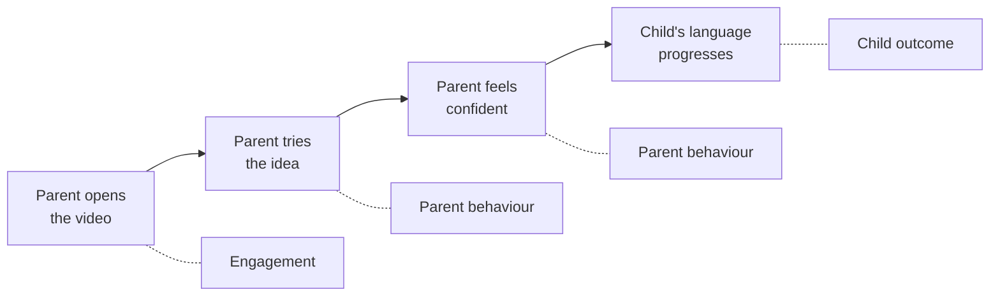
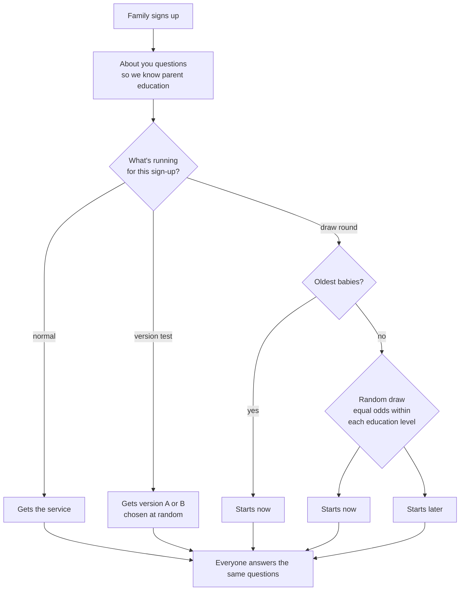
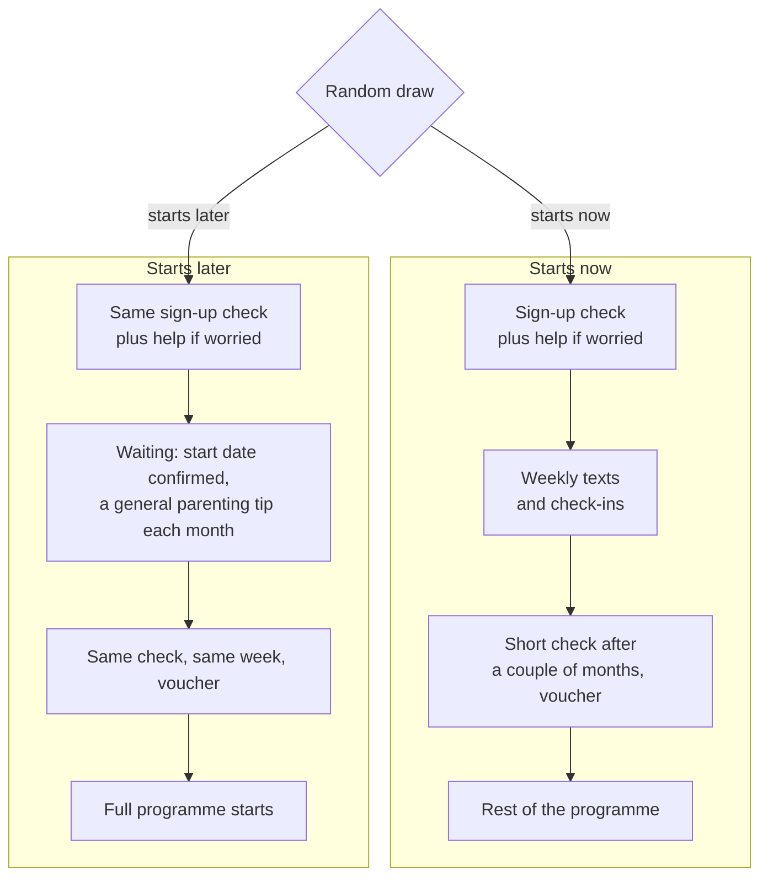
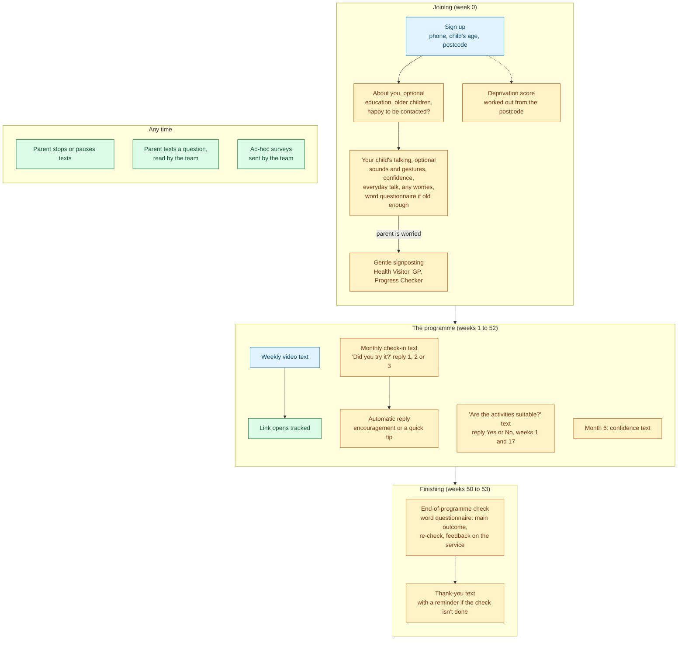
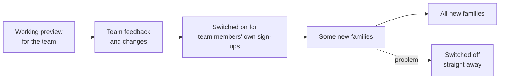

# Impact monitoring: approach

How we find out whether the CBeebies Parenting text service is making a
difference: what we measure, why, and how.

## The service in one paragraph

Parents of babies aged 6–18 months sign up at
[cbeebies-text.uk](https://cbeebies-text.uk). Each week they get a text with a
link to a short BBC Tiny Happy People video. Each video shows a simple, everyday
way to help their baby learn to talk, such as chatting back when the baby
babbles or taking turns making sounds. The aim is that parents use these ideas
day to day, and children's early language develops better as a result.

## Our starting point

A large university trial (Matthews et al., 2026, 803 families) tested a version
of this service. It found:

- **It helped babies, specifically in families where the parent doesn't have a
  university degree.** In those families, children's language caught up with
  their peers'. For older toddlers it made no measurable difference.
- **It worked through parents.** Parents who got the videos talked with their
  babies in more responsive ways, and that is what helps language grow.
- **Engagement drops over time.** About a third of links were opened on
  average, and fewer as the weeks went on.
- **Parents liked it, but time is the barrier.** 96% would recommend it, but
  lack of time was the most common reason for not using it.

The trial measured children through hour-long home visits, standardised tests
and filmed play sessions scored by researchers. That is right for a one-off
trial. It is far too costly and intrusive for a live national service. **Our
approach swaps those for light, automated signals collected through the service
itself.** We accept less precision in return for continuous, low-effort
monitoring that we can act on.

---

## 1. What we're prioritising and why

We follow the chain the trial found. If one step breaks, the later ones can't
happen, so we watch every step, starting with the cheapest and most reliable.

| Priority | What we measure | Why it matters | Effort for parents |
| --- | --- | --- | --- |
| **1. Engagement** | Share of video links opened each week; how many parents stop the service | Nothing else can happen unless parents open the content. It is also the earliest warning sign. | None: recorded automatically |
| **2. Parent behaviour** | Whether parents tried the week's idea, and how it went; how often they do everyday "talk" activities and enjoy playing together; how confident they feel helping their child talk, and handling feelings and sharing | This is how the service works. The trial's benefit came through changes in how parents talk with their child. | Very low: one text reply a month, plus a few taps at the start, middle and end |
| **3. Child progress (the main outcome)** | The words a child says (and understands), from an established parent questionnaire scored against what's typical for their age, at sign-up (if old enough) and at the end | This is the outcome we ultimately care about | Moderate: about 10 minutes, twice, with a thank-you voucher at the end |
| **4. Families who may need more help** | Share of parents who are worried about their child's communication; share who follow up on the help we point them to | To spot families who may need more than a weekly text, and point them to the right help early | Low: an optional check at sign-up |

**For every measure, we compare groups of families,** by:

- **whether the parent has a degree** (the trial's key finding)
- **how deprived their local area is**, worked out automatically from the
  postcode they give at sign-up
- the child's age
- home language

An average across everyone could hide the most important result: whether the
service reaches and helps the families it helps most. Deprivation also lets the
team **choose who to contact**, for example sending a survey to families in the
most deprived areas.

### Not just language

About a quarter of the weekly messages are about **bonding, feelings and
behaviour**, rather than talking. There are more of these as children become
toddlers: naming emotions, fears, tantrums, sharing. Language stays our main
outcome, because that's where the trial evidence is. We also keep a light eye
on the social and emotional side:

- **Each message is tagged by topic** (language, bonding, feelings and
  behaviour, physical, play), so we can see which kinds of content parents open
  and try.
- **Parents' confidence with "handling feelings and sharing"** is asked
  alongside their confidence with talking.
- **One question on enjoying playing together** gives a simple sign of the
  parent–child relationship.

### What we deliberately don't measure

| Not measuring | Why not |
| --- | --- |
| Home visits, standardised tests, filmed play | Too costly and intrusive at national scale |
| App-based child language tests (e.g. LanguageScreen) | Built for children aged 3 and over, not babies. They also record the child's voice and need a licence. |
| How long parents watch each video | The videos are on the BBC's website, so we can't see viewing once a parent leaves our link. We may get this from the BBC later. |
| Bookings for calls with a Speech and Language Therapist | We don't have a therapist service to offer yet. We point families to existing help and measure whether they follow it up. |
| A questionnaire on children's social and emotional development | Parked for now, to keep the end-of-programme check short. We track this side lightly instead (see "Not just language"). |
| Parents' own wellbeing or mental health | Out of scope for now. It's sensitive, and asking about it responsibly needs a proper support route. |

---

## 2. How we'll judge impact

Monitoring tells us how the service is running. Judging whether it **causes**
better outcomes needs three more things: one agreed main measure, fair
comparisons, and an analysis plan written down before we look at the results.

### The main outcome

**Children's language at the end of the programme**, measured with an
established parent questionnaire about the words a child says (and, where the
questionnaire supports it, understands). It is scored against what's typical
for the child's exact age.

- **Why one main outcome:** with lots of measures, something will always look
  good by chance. Naming one in advance keeps us honest. Everything else
  (confidence, everyday talk, engagement, feedback) is supporting evidence.
- **Why an established, age-scored questionnaire:** a 15-month-old and a
  20-month-old can't be compared on raw word counts. A questionnaire tested
  on thousands of UK children shows whether a child is ahead of or behind
  what's typical for their age. The lead option is the UK version of the
  widely used CDI word checklist, with a Welsh version for Welsh-speaking
  families. We use it exactly as published.
- **Who we look at most closely:** families where the parent doesn't have a
  degree, because that's where the trial found the effect.

### Fair comparisons

Children's language grows quickly whatever we do, so to judge impact we compare
families who got the service, or a particular version of it, with similar
families who didn't. Chance decides which group a family is in, which makes the
comparison fair. We use two kinds:

| Comparison | When | What it tells us |
| --- | --- | --- |
| **Version tests** | Whenever we change a feature | New families get version A or B at random, e.g. two wordings of the monthly check-in. **Shows which version works better.** Fits naturally with a service that keeps changing. |
| **Draw rounds** | Only when more families sign up than we have places for | Places are given out by random draw: some start now, some a couple of months later. **Shows whether the service works compared with not having it yet.** |

Two further comparisons run all the time. They're good for checking we're on
track, **but they aren't proof**:

- **Against the original trial:** are we reaching the same kinds of families,
  with similar engagement and feedback?
- **Between groups of families** who joined at different times or in different
  places: is the service working consistently as it grows?

### Draw rounds: what each group gets

- **The comparison** is the short check a couple of months in: same questions,
  same week, but only one group has had the service.
- **The oldest babies always start now**, so no child gets too old for the
  content while waiting.
- **Everyone has the same chance** within their education level, so no one
  gains by changing their answers.
- **Waiting families get a monthly general parenting tip** (sleep, feeding,
  teeth). It isn't about language, which is what's being tested.

**Why this is fair:**

- **No one loses out compared with today.** Today, families who sign up after
  the limit is reached get nothing. A delayed place is better than no place.
- **Everyone gets the full service in the end.** It's a short wait, not a
  refusal.
- **A draw is the fairest way to share limited places.** First come, first
  served favours families who happen to be online at the right moment.
- **The safety net isn't delayed.** Worried parents are pointed to help straight
  away.
- **It's explained before families sign up**, they can leave at any time, and
  it's only used when demand is higher than places. It also goes through an
  ethics review.

### The analysis plan, in brief

- **Written and published before we look at the results**, so the analysis
  can't be shaped by what we find.
- **Everyone counts.** Families are analysed in the group they were put in,
  whether or not they engaged. This stops the service looking better just
  because enthusiastic families stayed.
- **We account for age, starting point and background:** child's age,
  language at sign-up where we have it, parent education and deprivation.
- **We check whether the effect differs for parents without a degree**, as the
  trial did.
- **We report gaps honestly.** Not everyone answers. We report who did and
  didn't, by group, and test whether gaps change the conclusions.
- **Analysed independently** by our research partner or an independent
  analyst.
- **Scale matters.** Detecting a small but worthwhile effect needs hundreds of
  completed questionnaires per group, and thousands for the
  parent-education comparison. That's achievable as the service grows.

### Running the service comes first

Monitoring the service as it grows and changes matters more than perfect
research findings. So evaluation is a light layer on top:

| Always on, for every family | Only when it's cheap and fair |
| --- | --- |
| Monitoring: engagement, check-ins, confidence, child progress, who we reach | Version tests, when we're changing something anyway |
| Comparisons with the trial and between groups of families | Draw rounds, only when there are more sign-ups than places |
| A record of every change to the service, so we can see what difference it made | |

Evaluation never holds up delivery. If a draw isn't needed, we don't run one.
If something isn't working for parents, we change it, and the records show
when.

### How this changes as the service grows

| Stage | Places | How we judge impact |
| --- | --- | --- |
| **Now** | Limited | Monitoring, version tests, and draw rounds when oversubscribed |
| **Growing into new areas** | Area by area | As above. Possibly: areas waiting to launch as a comparison. |
| **Places for everyone eligible** | Unlimited | No draw, because nobody needs to wait. Version tests and monitoring. Possibly: linking to routine health visitor records. |

Over time, the question shifts from "does the service work?" (the original
trial plus draw rounds) to "is each new version better, and are we keeping the
gains as we grow?" (version tests plus monitoring).

**If the free service gets eligibility rules:**

- **By postcode:** families just over the line could be invited to answer the
  questions only. That gives a fair "just either side of the line" comparison,
  which only applies to families near the line.
- **By parent education:** best avoided. If the answer decides who gets the
  service, some parents will change it, which spoils the measure we rely on
  most.

---

## 3. Two kinds of measurement

| | **Core measures** | **Ad-hoc surveys** |
| --- | --- | --- |
| What for | Tracking change over time and comparing groups of families | One-off questions and exploratory research (e.g. the Early Insights survey) |
| How they're sent | Automatically, at fixed points in the parent's journey | By the team, to a chosen list of parents |
| Questions | Fixed wording, the same each time, so results can be compared | Written by the team in the survey builder and changed freely |
| Status | Mostly new (built into sign-up, the weekly texts and the end of the programme) | Live, and staying as it is |

If an ad-hoc question turns out to matter long term, it becomes a core measure.

---

## 4. A parent's journey and where we measure

**Live** means it runs today. **New** means it's planned.

Colours: blue = parent journey, green = live monitoring, amber = new monitoring.
The "Are the activities suitable?" text is live today, but replies aren't saved as data yet,
so it is marked new.

This journey is for **families who sign up after each feature is switched
on**. Families who joined before carry on exactly as now (see §7).

---

## 5. The mechanisms in more detail

### Engagement

| Mechanism | What it tells us | When | Status |
| --- | --- | --- | --- |
| Tracked video links | Whether each weekly link was opened, and by message topic | Every week | Live, improved: every open is counted, and automatic link previews from phones (which inflate open rates) are excluded |
| Delivery receipts | Whether each text arrived | Every text | Live |
| Opt-outs and pauses | Who stops, and when | Any time | Live |
| Nudge after 3 unopened links | Re-engages drifting parents | Once | Live |
| Website analytics | Where people drop out of sign-up and forms | Sign-up and forms | Live, extended to the new steps |

### Parent behaviour and experience

| Mechanism | What it tells us | When | Status |
| --- | --- | --- | --- |
| "Are the activities suitable?" text | Early satisfaction | Weeks 1 and 17 | Live. New: Yes/No replies saved as data |
| **Monthly check-in text** | Whether parents tried the idea: "1 = Yes, easy. 2 = Tricky. 3 = No time yet." Each reply gets a helpful automatic response. | Monthly | New (new sign-ups) |
| **Confidence, everyday talk and play** | How confident parents feel helping their child talk, and handling feelings and sharing; how often they do things like taking turns babbling; how often they enjoy playing together | Sign-up, month 6, end | New. Same questions every time, taken from the old Pre-programme survey so earlier answers still count. |
| **Feedback on the service** | Enjoyment, effort, time, fit with family life, and "would you recommend it?". Comparable with the trial. | End | New (part of the end-of-programme check) |
| Free-text replies | Questions and concerns, read by the team | Any time | Live |
| Ad-hoc surveys (e.g. Early Insights) | Deeper, exploratory feedback | When the team chooses | Live, unchanged |

### Child progress

| Mechanism | What it tells us | When | Status |
| --- | --- | --- | --- |
| **Word questionnaire (main outcome)** | An established questionnaire about the words a child says and understands, scored against what's typical for their age. Used exactly as published, in English or Welsh. | Sign-up (if the child is old enough) and end | New |

### Families who may need more help

| Mechanism | What it tells us | When | Status |
| --- | --- | --- | --- |
| **"Your child's talking" check** | A starting point to compare later results against, and whether the parent has any worries | Sign-up (optional) | New |
| **Gentle signposting** | Who we point to their Health Visitor, GP or the Speech and Language UK Progress Checker, and who follows it up | After the check | New |

### Background used to compare groups

| Information | How we get it | Status |
| --- | --- | --- |
| Child's age, postcode, language | Sign-up | Live |
| **Area deprivation** | Worked out automatically from the postcode using the latest official deprivation index for that nation. We record which version was used. The team can filter and select families by it. | New, high priority |
| Parent's education, older children, happy to be contacted | Optional questions during sign-up (previously in the Pre-programme survey) | New |

---

## 6. Keeping sign-up easy

Most of the old Pre-programme survey (5–10 minutes, sent after sign-up) moves
into sign-up itself. Only the questions we use to measure impact move over:
education, older children, confidence (talking, and feelings and sharing),
everyday talk and contact consent.
The rest, such as why parents signed up and how they heard about CBeebies, move
to a short ad-hoc "About you" survey that the team can send a few weeks in.

To keep sign-up easy:

- **Everything new is optional.** The child check can be skipped.
- **The welcome text is sent before the optional check**, so skipping never
  delays the service.
- **We watch the sign-up completion rate.** If it falls after a change, we
  move or remove questions.

---

## 7. How new features are introduced

**Families already using the service carry on exactly as now.** New features
are only for families who sign up after each one is switched on.

The only changes current families get are behind the scenes:

- fixing how survey answers are stored
- counting link opens more accurately
- saving their replies to "Are the activities suitable?" (the texts they get don't change)
- working out area deprivation from their postcode

Each new feature goes through the same steps:

- **The team sees it first.** Every new screen and text conversation is
  available as a working preview for admins, including a text-message simulator
  that shows exactly what parents would receive and how replies are handled.
  Nothing is sent.
- **It's switched on gradually**, and can be switched off instantly if
  something goes wrong.
- **We record when each feature was switched on and for whom**, so monitoring
  can show what difference each change made.

---

## 8. Making sure the data can be trusted

| Issue | What we're doing |
| --- | --- |
| Survey answers could, in principle, be saved under the wrong family | Fixing the survey form so each family can only save its own answers |
| Ticked-box answers are stored as a single block of text, and some options contain commas, so they can't always be counted reliably (especially across English and Welsh) | Storing each ticked option separately, in a form that works in both languages, and converting past answers |
| Changing a survey question's options after people have answered changes what their answers mean | Options can be added but not changed once a question has answers |
| Personal details in survey answers (e.g. email addresses for vouchers) aren't removed when other personal data is deleted | Marking these questions as personal, so their answers are deleted with the rest of a family's personal data after three years, and leaving them out of reports |
| Parents' own text replies are kept when other personal data is deleted | Believed to be intended (for research). We're reviewing it to confirm, documenting the decision, and checking the privacy notice covers it |
| Consent to be contacted is only recorded as a survey answer | Recording it properly on the parent's record at sign-up |
| The end-of-programme text isn't being sent today, because the survey it links to doesn't exist | Flagging it now, then replacing it with the new end-of-programme check |
| Phones open links automatically to show previews, which looks like a parent opening the video | Not counting these as opens |
| Results could be skewed if the wording changes between timepoints | Using the same questions and scales at every point, and recording which version each answer used |

---

## 9. Principles

- **Low effort for parents.** At most about one extra text a month. Nothing is
  sent in a week that already has another extra text or a team survey.
- **Supportive, never alarming.** No labels like "delay" or "at risk". Wording
  is checked with a Speech and Language Therapist where possible.
- **Our own records are the source of truth.** Website analytics miss anyone who
  declines cookies, so we use them only to see where people drop off.
- **Private by design.**
  - Reports show groups, never individuals.
  - Very small groups are hidden.
  - Analytics tools never see answers.
  - A data protection impact assessment comes before launch.
- **Bilingual.** Everything parents see is in English and Welsh.
- **Roll out gradually.** New features are for new sign-ups only, previewed by
  the team first, then switched on step by step (§7). Changes are tested by
  giving different versions to randomly chosen new families.

---

## 10. What this can and can't tell us

**It can tell us:**

- whether parents are engaging, and where they drop off
- which ideas parents find hard to try
- whether parents' confidence and everyday talk change
- whether children are progressing compared with what's typical for their age
- whether we're reaching families in deprived areas, and parents without a
  degree
- whether we're on track compared with the original trial

It gives early warnings we can act on within weeks.

**Whether the service *caused* better outcomes** can only come from the fair
comparisons in §2:

- versions assigned at random show **which version is better**
- draw rounds, when there are more sign-ups than places, show **whether the
  service works compared with not having it yet**

Comparisons with the trial and between groups of families help us check we're
on track. On their own they aren't proof.

Parents' own reports are less precise than researcher-led tests, and parents
who've learned about babbling and gestures may notice more of them. Using an
established questionnaire, comparing groups who all answer the same way, and
analysing the results independently all reduce this, but don't remove it.

---

## Glossary

| Term | Meaning |
| --- | --- |
| **Open rate / click-through** | Share of parents who tapped the video link in a text |
| **Opt-out** | A parent texting to stop the service |
| **Deprivation index (WIMD in Wales, IMD in England, SIMD in Scotland, NIMDM in Northern Ireland)** | Official ranking of how disadvantaged each small local area is, published separately by each nation and updated every few years. We place each family in a band from 1 (most deprived 10% of areas) to 10 (least deprived). Bands are only compared within the same nation. |
| **Speech and Language Therapist** | A health professional who supports children's communication |
| **Signposting** | Pointing a family to existing help, rather than providing it ourselves |
| **Health Visitor** | NHS nurse who supports families with young children |
| **Main (primary) outcome** | The one measure, agreed in advance, that decides whether the service is working |
| **Age-scored (age-normed) questionnaire** | A questionnaire tested on many children, so a child's answers can be compared with what's typical for their exact age |
| **Random allocation** | Using chance to decide who gets what, so the groups are alike in every other way. This is the basis of a fair comparison. |
| **Version test** | New families randomly get one of two versions of a feature, to see which works better |
| **Draw round** | When there are more sign-ups than places, a random draw decides who starts now and who starts a couple of months later |
| **Pre-registration** | Publishing the analysis plan before seeing the results |
| **Core measure / ad-hoc survey** | An automatic, repeated measurement vs a one-off survey sent by the team (see §3) |

*Sources: Matthews et al. (2026), Can Digital Parenting Interventions Benefit
Early Language Development?; internal notes on impact measurement and
monitoring approach; the live Pre-programme and Early Insights surveys.
Implementation detail is in [impact-monitoring-dev-plan.md](impact-monitoring-dev-plan.md).*
